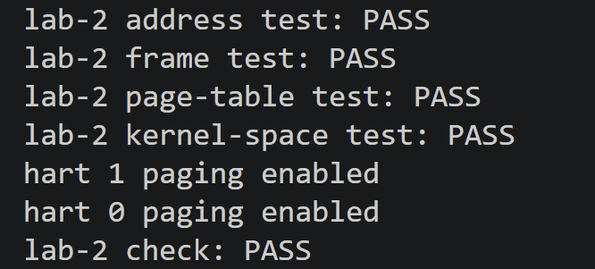
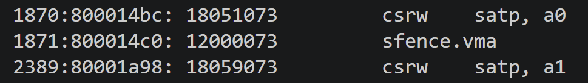

# ECNU OSLab 2026 实验报告：Lab 2 物理内存与内核虚拟内存

## 1 实验信息

| 项 | 内容 |
|---|---|
| 仓库 / 分支 | github.com/SiriLee/rCore-Tutorial-v3 / `lab-2`（基于已验收的 `lab-1`） |
| 实验提交 | `4795985a` `2ab64d41` `d6c8d99b` `9abc7319` `ae67b372` `660acb46` `5ef7eb2b` · 记录 `ece51179` |
| 完成日期 | 2026-09-28 |
| 宿主环境 | WSL2 / Ubuntu 24.04.3 LTS / x86_64 |
| 工具链 | rustc 1.98.1、cargo 1.98.1、QEMU 8.2.2、rust-objdump（LLVM 22.1.8）、openspec 1.11.0 |
| 目标平台 | RISC-V 64（riscv64gc-unknown-none-elf），QEMU `virt`，`-smp 2` |

Lab 2 起始材料是覆盖层而非独立工程：先复制已验收的 `lab-1/` 为 `lab-2/`，再用 `lab-2/starter/` 覆盖新增与替换的文件。覆盖层把每个 hart 的启动栈由 4 KiB 扩至 16 KiB（`entry.S` 中步长 `16384`），因为页表构造与自检调用链更深，沿用 4 KiB 会导致两 hart 栈重叠（典型症状是串口两次输出 `hart 0`）。

## 2 实验目的与内容

管理内核启动后可用的物理内存，并建立内核虚拟内存：

1. 从链接脚本取得内核结束地址，只管理内核镜像之外的 RAM；
2. 把空闲物理内存切分为 4 KiB 页，用空闲链表完成分配与回收；
3. 分配物理页时清零，内存耗尽时不覆盖正在使用的页；
4. 实现 Sv39 三级页表的建立、查询与解除映射；
5. 为内核各段、剩余 RAM 与 UART 建立恒等映射，并发布 `satp` token；
6. 两个 hart 使用同一张内核页表，启用分页后继续正常运行与输出。

本实验不涉及用户地址空间、页故障、按需分配、换页、堆分配与进程调度。

## 3 实现要点

| 任务 | 关键点 |
|---|---|
| 页帧分配器 | 空闲链表节点存于页首机器字；管理区间 `[0x8000d000, 0x88000000)`，共 32755 页（127.95 MiB）；分配时先摘链解锁**再**清零，否则会抹掉 next 指针；回收时断言区间、对齐并检测重复释放与环 |
| 三级页表 | PTE = `PPN << 10 \| flags`；`map` 统一补 `V` 位并拒绝重复映射、`W=1,R=0`、无 `R/W/X`；创建型遍历记录新建的父 PTE，失败时**先清父 PTE 再释放页帧**；只查询的遍历绝不分配；本实验只支持 4 KiB 叶子，VPN2/VPN1 层遇叶子即报错 |
| 内核地址空间 | 恒等映射（VA == PA）分段设权限，见下表；发布 token 前 `fence`，`Release`/`Acquire` 同步，随后 `core::mem::forget(page_table)` 使页表页终身不被回收 |
| 分页激活 | `csrw satp` 切换页表根，紧跟 `sfence.vma` 丢弃旧地址转换缓存 |
| 集成流程 | hart 0 独占初始化；两 hart 经 `STARTED` 同步后等待 `kernel_token()`，再各自激活分页并输出 |

分段映射（合计 32769 次 `map`，所有内核页均不设 `U` 位，无段同时具有 `W` 与 `X`）：

| 区域 | 区间 | 权限 | 页数 |
|---|---|---|---|
| text | `[0x80000000, 0x80003000)` | `V\|R\|X` | 3 |
| rodata | `[0x80003000, 0x80004000)` | `V\|R` | 1 |
| data | `[0x80004000, 0x80004000)` | `V\|R\|W` | 0（空段） |
| BSS 与启动栈 | `[0x80004000, 0x8000d000)` | `V\|R\|W` | 9 |
| 剩余 RAM | `[0x8000d000, 0x88000000)` | `V\|R\|W` | 32755 |
| UART | `[0x10000000, 0x10001000)` | `V\|R\|W` | 1 |

**页表帧预算**：按 Sv39 索引独立计算，distinct VPN2 = 2、distinct (VPN2, VPN1) = 65，故页表帧 = 1 + 2 + 65 = 68，上限 `MAX_PAGE_TABLE_FRAMES = 128`，余量 60。任何扩大映射范围的改动都必须先重算预算，否则 `kernel_space_init` 返回 `Err`。

## 4 验证结果

| 验证项 | 命令 | 结果 |
|---|---|---|
| OpenSpec 规格 | `openspec validate --all --strict` | 2 passed, 0 failed |
| 代码格式 | `cargo fmt --check` | 无输出，退出码 0 |
| TODO 清理 | `rg -n TODO src/mm src/main.rs` | 无输出 |
| 指令证据 | `rg -n 'satp\|sfence\.vma' kernel.asm` | `csrw satp, a0`（`0x800014bc`）+ `sfence.vma`（`0x800014c0`） |
| 自动验收 | `make clean && make check` | `lab-2 check: PASS` |

自动验收输出：四项自检全部 PASS，两个 hart 均启用分页后继续输出。

```text
lab-2 address test: PASS
lab-2 frame test: PASS
lab-2 page-table test: PASS
lab-2 kernel-space test: PASS
hart 1 paging enabled
hart 0 paging enabled
lab-2 check: PASS
```



*图 1：`make clean && make check` 的末屏。地址类型、页帧分配器、三级页表、内核地址空间四项自检均为 PASS，两个 hart 以同一 token 输出 `paging enabled`，证明页帧管理与 Sv39 映射在真实 MMU 下可用。*



*图 2：`kernel.asm` 中相邻的 `csrw satp, a0` 与 `sfence.vma`（分页激活函数）。证明分页由真实指令启用，且切换页表根后刷新了 TLB。*

## 5 问题与结论

**问题 1（编译期可见）**：页表自检比较 `Option<PageTableEntry>`，而骨架只派生 `Copy, Clone`，报 `E0369`。`PageTableEntry` 是 `#[repr(transparent)]` 的整数封装，补 `PartialEq` 即可。

**问题 2（编译期不可见，最危险）**：`PteFlags::contains` 的语义是「全部位都包含」。`map` 中用它判断「是否至少有一种叶子权限」时，`(R|W) & (R|W|X) = 0x6 ≠ 0xE`，表达式对所有合法权限恒为 `false`，取反后一律判定非法——**结果是每次 `map` 都失败，而编译器无法发现**；若跳过内存自检直接进入后续任务，症状会退化为静默的 QEMU。修正是区分两种语义：单标志检查继续用 `contains`，多标志掩码改用 `intersects`（`(self & flags) != 0`）。

**结论**：OpenSpec strict 校验、`cargo fmt --check`、`make clean && make check`（四项自检、两 hart `paging enabled`、`lab-2 check: PASS`）全部通过；内核恒等映射的分段权限、`U` 位与 W^X 经独立三级走查逐页核对。实验完成，可进入 Lab 3。
