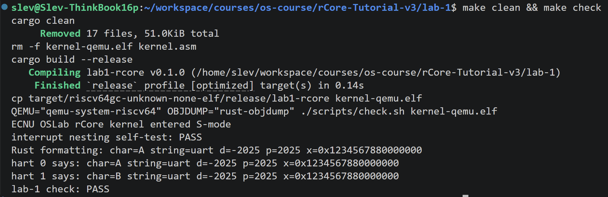
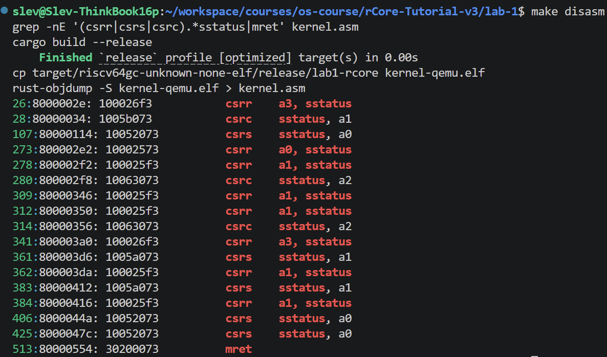

# ECNU OSLab 2026 实验报告：Lab 1 机器启动与并发安全输出

## 1 实验信息

| 项 | 内容 |
|---|---|
| 仓库 / 分支 | github.com/SiriLee/rCore-Tutorial-v3 / `lab-1` |
| 实验提交 | `62c37f03`（实现）· `f2bd86a7`（记录） |
| 完成日期 | 2026-09-21 |
| 宿主环境 | WSL2 / Ubuntu 24.04.3 LTS / x86_64 |
| 工具链 | rustc 1.98.1、cargo 1.98.1、QEMU 8.2.2、rust-objdump（LLVM 22.1.8）、openspec 1.11.0 |
| 目标平台 | RISC-V 64（riscv64gc-unknown-none-elf），QEMU `virt`，`-smp 2` |

环境差异说明：材料要求 Rust 1.98.0，实际为 1.98.1。原因是仓库基线自带的 `rust-toolchain.toml`（`channel = "stable"`）优先级高于 `rustup override`，且课程 `check-env.sh` 与 OpenSpec 规格均未约束具体版本号，故保留仓库原始配置，不做修改。

## 2 实验目的与内容

从 QEMU 复位入口构建一个 Rust 裸机内核，并保证双 hart 并发输出安全：

1. 生成入口地址 `0x80000000`、入口符号 `_entry` 的 RISC-V 64 位 ELF；
2. 在入口汇编中读取 hart ID，为两个 hart 分配互不重叠的 4 KiB 启动栈；
3. 配置 PMP、`mstatus`、`mepc`、`satp`、`tp`，通过 `mret` 由 M-mode 进入 S-mode；
4. 实现 QEMU virt 的 16550 UART 驱动与 `core::fmt` 格式化输出；
5. 实现关中断自旋锁，使一次整行输出成为互斥临界区；
6. 用 Release/Acquire 同步 UART 初始化，验证双 hart 均能完整输出。

## 3 实现要点

1. **入口与栈**：`entry.S` 按 `mhartid` 计算 `boot_stack + (hart + 1) * 4096`，hart 0 栈为 `[0x80002000, 0x80003000)`、hart 1 为 `[0x80003000, 0x80004000)`，两区间不重叠。
2. **特权级切换**：设置 PMP 允许 S-mode 访问全部物理内存，`mstatus.MPP = S`、`mepc = start`，`mret` 后进入 S-mode。
3. **UART 输出**：轮询 `0x10000000` LSR 的 THR 空位后写 THR；基于 `core::fmt::Write` 支持字符、字符串与整数格式化。
4. **并发安全**：自旋锁在取锁前执行 `csrc sstatus`（清 `SIE`）并记录嵌套深度，解锁后按深度恢复，保证单条消息不被另一 hart 的字符插入；UART 初始化用 `STARTED` 的 Release/Acquire 同步。

## 4 验证结果

| 验证项 | 命令 | 结果 |
|---|---|---|
| OpenSpec 规格 | `openspec validate --all --strict` | 1 passed, 0 failed |
| 代码格式 | `cargo fmt --check` | 无输出，退出码 0 |
| 自动验收 | `make clean && make check` | `lab-1 check: PASS` |
| TODO 清理 | `rg -n TODO src` | 无输出 |

自动验收的五条规定输出（两条 hart 消息行内完整、互不交错）：

```text
ECNU OSLab rCore kernel entered S-mode
interrupt nesting self-test: PASS
Rust formatting: char=A string=uart d=-2025 p=2025 x=0x1234567880000000
hart 0 says: char=A string=uart d=-2025 p=2025 x=0x1234567880000000
hart 1 says: char=B string=uart d=-2025 p=2025 x=0x1234567880000000
lab-1 check: PASS
```



*图 1：`make clean && make check` 的末屏。两个 hart 各自输出完整一行、消息内部无交错字符，且自检与验收均为 PASS，证明并发输出互斥与 S-mode 启动均成立。*



*图 2：`kernel.asm` 中 `csrw sstatus` / `mret` 及 AMO、fence 指令。证明特权级切换由真实指令完成，而非仅在源码层面声明。*

## 5 问题与结论

**问题**：Lab 1 的任务 1–7 未按任务拆分提交，而是合并为单个提交 `62c37f03`，与材料 README「分任务构建、运行和提交」的要求存在粒度偏差。已推送的历史不改写，从 Lab 2 起按任务小步提交。

**结论**：四项验收（OpenSpec strict 校验、格式检查、`make check` 输出 `lab-1 check: PASS`、手工 `make qemu` 启动与 `Ctrl+A` `X` 退出可重复）全部通过，实验完成，可进入 Lab 2。
